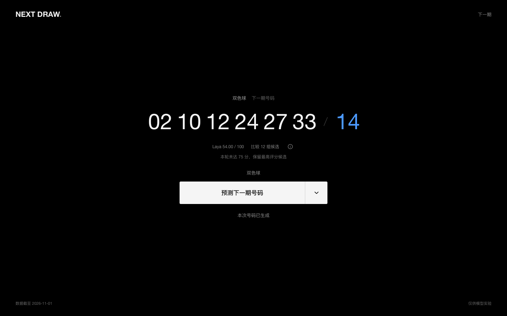

# Next Draw

一个可自行部署的号码模型实验网页。PyTorch LSTM + CRF 从历史开奖数据生成合法候选，本地 Laya 决策模型按明确的偏好比较候选，FastAPI 与 React/TypeScript 提供简洁的黑白交互界面。

**仅用于学习、研究和娱乐，不提供中奖保证。75/100 是候选偏好评分，不是中奖概率。** 项目不包含账号、支付、投注或购买彩票功能。



## 功能概览

- 双色球、大乐透和七乐彩；七星彩因数据和模型未完成验证而禁用。
- 历史结果按日期保存在 JSON 中，只增量获取新增及少量重叠期次，有效修正保留溯源。
- 模型按数据和配置指纹缓存，历史未变时不重复训练。
- Laya 在本地运行，不需要 API Key；最多比较三轮，不通过伪造分数凑到门槛。
- 真实阶段提示、旋转等待环、淡入淡出、双色球蓝球配色及桌面/移动端布局。
- 任务排队、取消、超时、刷新恢复、重复请求保护和明确的缓存警告。
- 单容器部署，非 root、只读根文件系统、数据卷持久化。

## 技术栈

| 层次 | 技术 |
| --- | --- |
| 前端 | React19、TypeScript、Vite6、Lucide、CSS transitions |
| API | Python3.11、FastAPI、Uvicorn |
| 号码模型 | PyTorch2.15 CPU、LSTM、pytorch-crf |
| 决策模型 | Laya0.4.21 multilingual，本地 safetensors 权重 |
| 数据 | BeautifulSoup、curl-cffi、带时区的 JSON、文件锁和原子写入 |
| 环境与部署 | uv、`.ExData` 虚拟环境、Docker Compose |
| 测试 | pytest、HTTPX、Playwright / Chrome |

## 适用平台

| 平台 | 状态 |
| --- | --- |
| Apple Silicon macOS + Docker Desktop | 已实测，原生 ARM64，不需要 Rosetta |
| Linux ARM64 + Docker Engine/Compose | 目标架构兼容；未在独立物理服务器上验收 |
| Intel/AMD x86_64、Intel Mac、Windows | 默认 Compose 固定 ARM64；未验证，不承诺原生兼容 |
| 浏览器 | Chrome 已自动化验证；其他现代浏览器未逐项验收 |

默认限制4核、3GB容器内存，建议为 Docker 预留至少4GB可用内存及约6GB可用磁盘。性能与实际硬件、其他容器负载有关，不需要 CUDA/GPU。

## Docker 快速部署

前提：已安装并启动 Docker，支持 Compose V2+。宿主机不需要安装 Python 或 Node.js。

```sh
git clone https://github.com/enabled528/next-draw.git
cd next-draw
docker compose up -d --build --wait
```

打开 <http://127.0.0.1:8787>。首次构建下载 Python/前端依赖及约647MB公共模型文件，并验证固定 SHA-256，因此需要能访问官方镜像仓库、包仓库与 Hugging Face。已有有效模型文件时直接复用。

模型权重和虚拟环境不上传 GitHub；Docker 构建会自动准备权重。运行时使用离线模型，只有公开开奖查询需要联网。若下载站暂不可达，请修复网络后重试，不要关闭 TLS 校验。

## 启动与停止

```sh
docker compose ps
docker compose logs --tail 50
docker compose stop
docker compose start
docker compose up -d --build --wait  # 更新源码后的重建
```

Docker 启动时，`restart: unless-stopped` 会自动恢复此前未手动停止的服务。手动 `stop` 后需要再次 `start`。修改端口可用 `NEXT_DRAW_PORT=8788 docker compose up -d`。

仅绑定本机回环地址，不默认暴露到局域网或公网。项目没有身份认证；不要未经额外访问控制直接修改为公网监听。

基础镜像使用 [Docker 官方镜像的 ECR 分发](https://gallery.ecr.aws/docker/)，uv 使用其[官方 GHCR 镜像](https://docs.astral.sh/uv/guides/integration/docker/)。这不需要修改全局 Docker 镜像源。

## 页面操作

- 点击右侧向下箭头，在双色球、大乐透、七乐彩之间选择。七星彩因历史来源和模型未验证而禁用。
- 点击主按钮开始。圆环及文字显示真实任务阶段：检查历史、增量获取、加载或训练、检查留出数据、生成候选、Laya 比较、整理结果。
- 完成后显示一组号码，双色球最后一个蓝球显示为蓝色。信息图标展开运行记录。
- 取消会终止正在执行模型的子进程；后续运行会从磁盘缓存恢复。模型进程若超过 600 秒，也会被终止并释放队列。
- 刷新会恢复已有任务；提交响应丢失时，使用持久化请求标识恢复，不重复排队。永久丢失的任务会退出重连状态，允许重新运行。

## 模型与评分

1. 前区采用号码嵌入、每个位置独立的时间 LSTM、位置间 LSTM、发射分数和线性链 CRF；后区采用多层 LSTM，大乐透后区也使用 CRF。
2. 保留 Keras 风格的 forget bias 和训练期锁定 recurrent dropout 思路。CRF 损失及 Viterbi 使用 `pytorch-crf`，不自行重写核心算法。
3. 这是重新训练的 PyTorch 实现，不是 TensorFlow 权重转换，也不声称逐位数值完全等价。合法递增解码约束避免同一区域号码重复。
4. 默认窗口 3 期、嵌入/隐层宽度 32、训练 3 轮。按时间取前 80% 训练，使用最近最多 100 条未参与训练的目标检查命中数，并记录同预算随机前区基线；最后再用全部已知历史训练一轮。
5. 模型和数据指纹一致时直接复用；数据有新增或有效修正时才重新训练。检查报告保留训练截止期、留出期范围和最终训练截止期，避免把最终训练后的成绩当作留出成绩。
6. 每轮由学到的发射分数和 CRF 路径产生 4 组不同的合法候选。Laya 根据明确的奇偶、大小、上期重合和连号偏好选择及评分。
   完整历史仍保存在 JSON 中；在线 Laya 只读取候选和压缩特征，不把全部历史塞入有限上下文。
7. **75/100 是实验偏好评分，不是中奖率，也不是 Laya 的置信度。** 最多 3 轮，仍未达到时显示最高评分候选及未达门槛提示。Laya 不可用、答案无效或输入截断时真实报错，不使用伪造评分或规则替代模型。

历史检查的直白含义是：只让模型看较早的开奖，再看看它给较晚的已知期次选出的号码，与实际号码重合了几个。它用于检查程序和比较模型，不代表下一期表现。

## 数据与持久化

Compose 卷：`next-draw_next-draw-data`，挂载至 `/app/data`。

| 路径 | 内容 |
| --- | --- |
| `/app/data/history/{ssq,dlt,qlc}.json` | 带开奖日期、采集时间、来源、最新期号的历史快照 |
| `/app/data/checkpoints/*.pt` | 按数据及配置指纹保存的模型参数和检查报告 |
| `/app/data/jobs/*.json` | 阶段事件、结果、原始 Laya 决策、候选、种子和耗时 |
| `/app/data/requests/*.json` | 用于重复提交保护的哈希请求索引 |
| `seed/*.json` | 已验证的首次启动历史种子 |
| `verification/` | 本地测试生成的输出，已忽略，不上传仓库 |

增量同步先查询最新期号，再从本地最后约 5 期开始获取，覆盖重叠记录以发现修正。6 小时内不重复查询；公开来源不可用时使用已有快照并明确警告截止日期。有效修正会保留 previous/replacement 溯源。重复期号、非法号码、未来或不一致日期在原子替换之前拒绝。

`docker compose down` 不删除数据卷；**不要使用 `down -v`**，除非确实要清空所有历史、模型和任务。重建镜像不会清空该卷。本地直接运行时相同结构位于 `.data/`，与 Docker 数据卷独立。

## 本机开发

需要 uv、Python3.11、Node.js24 和 npm。Python 包全部由 uv 安装到 `.ExData`，不安装到系统 Python；此依赖组合尚未迁移到 Python3.12。

```sh
cd next-draw
UV_PROJECT_ENVIRONMENT=.ExData uv sync --frozen
.ExData/bin/python scripts/download_model.py
PYTHONPATH=backend .ExData/bin/uvicorn next_draw.api:app --host 127.0.0.1 --port 8008
```

另一终端启动前端（Vite 将 `/api` 代理到 8008）：

```sh
cd next-draw/frontend
npm ci
npm run dev -- --host 127.0.0.1 --port 4173 --strictPort
```

打开 <http://127.0.0.1:4173>。源码中的模型维度位于 `backend/next_draw/training.py`；Docker CPU 依赖另存为带哈希的 `requirements-linux-arm64.txt`，不安装 CUDA 包。

| 环境变量 | 默认值/用途 |
| --- | --- |
| `NEXT_DRAW_PORT` | Compose 宿主端口8787 |
| `NEXT_DRAW_DATA` | 本地`.data`；容器`/app/data` |
| `NEXT_DRAW_LAYA_DIR` | 本地`vendor/laya` |
| `NEXT_DRAW_THREADS` | 最多4个 CPU 线程 |
| `NEXT_DRAW_EPOCHS` | 初始训练3轮 |
| `NEXT_DRAW_FRESHNESS_SECONDS` | 21600秒，历史检查间隔 |

可在 Compose 的 `environment` 中修改运行参数，或在本机运行前设置环境变量。修改模型训练配置会产生不同的数据/配置指纹。

## Laya 离线文件

固定仓库 `convaiinnovations/laya`，multilingual 子目录，revision `55cf4c4ebb4ebe31b2550e8bdf3bd21b99753851`。权重 SHA-256：`9d628fd971b700382ac6f65920a86f149777b2e748e0c955fb3b19695aa8f204`，加载时验证。

运行文件包括 `model.safetensors`、`rl_agent_config.json`、`encoder/config.json` 和 `tokenizer/`。下载脚本使用 Python 标准库，从固定 revision 下载并逐个验证五个文件的 SHA-256；验证失败不会替换已有文件，合法缓存会复用。手动准备时在仓库根目录执行：

```sh
python3.11 scripts/download_model.py
```

Docker 已将这些文件打包，并设置 Hugging Face/Transformers 离线模式；网页请求不发送历史记录到外部 AI 服务。唯一常规外部请求是公开开奖数据查询。

## 接口与验证

| 接口 | 用途 |
| --- | --- |
| `GET /api/health` | 健康状态、实际架构 |
| `GET /api/games` | 支持状态、数据截止日期及条数 |
| `POST /api/predictions` | JSON `{"game":"ssq","request_id":"唯一请求标识"}`，返回任务 |
| `GET /api/jobs/{id}` | 阶段、结果或失败信息 |
| `POST /api/jobs/{id}/cancel` | 取消任务 |

队列最多接收 4 个活动任务，模型串行执行，暖进程复用模型。请求标识跨重启去重；相同标识不能更换彩种。错误分别使用 404、409、422、429，不将失败伪装为成功。

```sh
.ExData/bin/python -m pytest
cd frontend
npm run typecheck
npm run build
npm run test:sites
npm run test:ui
LIVE_API=1 BASE_URL=http://127.0.0.1:8787 npm run test:ui -- --grep 'live local models'
```

界面测试需要4173开发服务器已启动，或设置 `BASE_URL=http://127.0.0.1:8787` 指向运行中的容器。Playwright 使用已安装的 Chrome 和独立临时配置，不读取用户浏览器资料。`ui.spec.ts` 使用固定响应检查交互；`live.spec.ts` 显式调用真实服务、三个彩种及 Laya。实际验证概况见 [验证记录](docs/verification.md)，设计依据见 [DESIGN.md](DESIGN.md)。

## 目录结构

```text
backend/next_draw/   API、任务、历史数据、号码模型和 Laya
frontend/           React/TypeScript 界面与浏览器测试
scripts/            固定版本模型下载和命令行预测
seed/               带来源信息的初始历史事实数据
tests/              Python 测试
docs/               正式截图和验证说明
vendor/laya/        本地模型目录，权重不入 Git
compose.yaml        单服务部署和专属持久卷
```

## 免责声明

- 彩票开奖具有随机性。项目未证明存在可靠预测优势，不保证任何中奖、收益、准确率或评分门槛。
- Laya 分数仅表示指定偏好的模型评分，历史留出检查和随机基线不是未来表现的保证。
- 不构成投资、投注、财务或专业建议；不得将软件用于非法用途、自动投注或误导性收益宣传。
- 使用者应独立判断风险，遵守所在地适用规则和第三方数据、模型及软件许可；不要因输出增加投注或承担无法承受的损失。
- 软件按现状提供，不保证数据来源持续可用、记录完整或无误；在适用法律允许范围内，作者不承担使用或无法使用产生的损失，具体以许可证为准。

## 开源许可

本项目原创源码采用 [Apache License 2.0](LICENSE)，Copyright2026 enabled528。可以依许可证使用、修改和分发，需保留相关许可证及通知。第三方软件、数据、模型权重、分词器和商标不因本项目而被重新许可，说明见 [NOTICE](NOTICE)。

上游 `predict_Lottery_ticket` 作为架构思路参考；其未附明确许可的源码不随本仓库分发。Laya 由依赖管理器另行安装，公共模型按上游条款单独下载。

## 参考

- [原 LSTM + CRF 项目](https://github.com/zepen/predict_Lottery_ticket)，参考 commit `cf9f0ed76ff7adbddbc553bd71a82e7acd60b86f`。
- [Laya](https://github.com/NandhaKishorM/laya)，本地使用 PyPI `laya==0.4.21`，不需要 API Key。
- [本地 multilingual 权重来源](https://huggingface.co/convaiinnovations/laya/tree/55cf4c4ebb4ebe31b2550e8bdf3bd21b99753851/multilingual)。
- [公开开奖历史来源](https://datachart.500.com/)。这是第三方公共页面适配器，页面结构变化时需要维护，不是承诺稳定的官方数据 API。

本项目与彩票发行机构、数据站点及参考设计品牌不存在隶属或背书关系。
