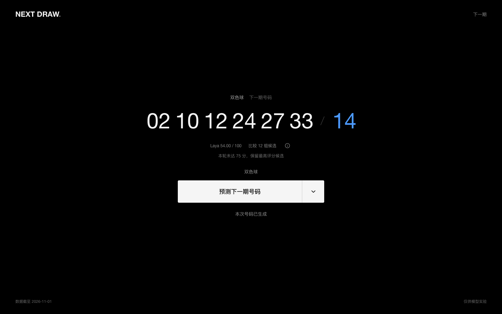
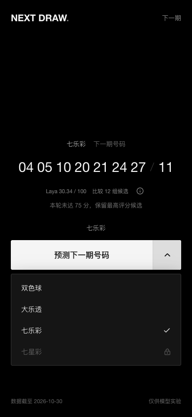

# 验证记录

验证日期：2026-11-02。环境为 Apple Silicon 上的 Docker Desktop，镜像为原生 `linux/arm64`，Python3.11、CPU-only PyTorch、本地离线 Laya。

- 发布整理前：47 项后端测试、9 项界面测试、4 项前端打包测试通过；真实浏览器对双色球、大乐透、七乐彩均完成端到端运行。
- 响应式检查覆盖320、390、601、680、740、768、800、1024、1440px；检查蓝球颜色、数字溢出、菜单键盘交互、错误/取消/重连和减少动画设置。
- 三份历史 JSON 和三份模型文件在容器重建前后 SHA-256 相同；重启后报告 `model_source=disk`，没有重新训练。
- 容器内真实增量同步成功；在 Laya 计算阶段取消任务，约0.18秒进入取消状态，之后可再次运行。内存模型复用时，实测完整一轮约10秒，硬件和负载会影响耗时。
- 发布整理增加了模型下载、校验失败保护和缓存复用测试，完整后端套件49项通过；TypeScript检查、前端构建、4项打包测试和带模型校验的新镜像构建通过。

发布时当前网络无法直连 Hugging Face，因此镜像构建复用了本机已经逐文件校验的模型。未声称在当前网络完成了从零远程下载验证；新环境首次构建需要具备该站点的网络可达性。下载路径的缓存和错误保护通过隔离测试覆盖。

保留的正式界面示例：

截图来自真实运行，不表示号码具备预测价值。临时浏览器配置、原始测试输出和下载缓存不随仓库发布。
